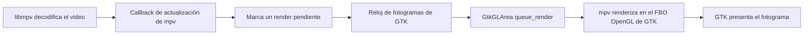

# Reproducción y renderizado de video

Este documento describe cómo Cine conecta la decodificación de `libmpv` con el
renderizado OpenGL de GTK, por qué aparecía tirón durante la reproducción y qué
cambios se hicieron para reducirlo.

## Ruta de un fotograma

La decodificación y la presentación son etapas distintas. `hwdec=auto` puede
delegar la decodificación a la GPU, pero GTK todavía debe recibir y dibujar cada
fotograma a tiempo.

La implementación está en `src/mpv_gl_area.rs`. `GtkGLArea` no usa el modo de
renderizado automático: Cine solicita un dibujo cuando `libmpv` notifica una
actualización. `src/mpv_engine.rs` enlaza `mpv_render_context_render()` con el
FBO OpenGL que GTK tiene activo.

## Causa del tirón

La primera ruta enviaba cada notificación de mpv a una tarea `idle` de GLib. Esas
tareas podían esperar detrás de otros eventos antes de pedirle a `GtkGLArea` que
dibujara. Además, `mpv_render_context_render()` puede esperar a la hora de
presentación calculada por mpv mientras se ejecuta en el hilo principal de GTK.
Durante esa espera, el mismo hilo no puede atender otros eventos ni preparar el
siguiente fotograma.

Por eso tener NVDEC activo no bastaba: la GPU podía decodificar correctamente,
pero la solicitud de dibujo y la presentación llegaban tarde. La documentación
de mpv explica que el render API puede bloquear hasta la hora objetivo y que
`video-timing-offset` controla esa espera para clientes que integran el
renderizado. Véase [el manual de mpv](https://mpv.io/manual/master/).

## Cambios aplicados

1. El callback de mpv marca de forma atómica que hay un dibujo pendiente; no
   crea una tarea `idle` por cada actualización.
2. `GtkGLArea` consume esa marca desde `add_tick_callback`, alineando la
   solicitud de dibujo con el reloj de fotogramas de GTK. Las actualizaciones
   repetidas se agrupan en vez de acumular solicitudes atrasadas.
3. Cine establece `video-timing-offset=0` al crear el handle de mpv. GTK ya
   organiza cuándo se dibuja el `GtkGLArea`, así que mpv no necesita mantener
   bloqueado el hilo principal esperando su hora objetivo antes de devolver el
   render.
4. Las métricas locales cuentan avisos, solicitudes, renders, duración de
   `mpv_render_context_render()`, intervalo entre renders y espera hasta el
   siguiente dibujo. Cada cinco segundos también consultan los contadores
   acumulados de mpv y la frecuencia del reloj de fotogramas de GTK. Las
   consultas de contadores se hacen al informar, no en cada fotograma ni
   mientras se sostiene el mutex de métricas. Mantener ese mutex durante una
   consulta síncrona a mpv podía bloquear el callback de actualización y
   congelar el render.
5. Al iniciar, Cine captura stdout y stderr —incluidos mensajes de mpv y errores
   de pánico— en un archivo persistente. La ruta predeterminada es
   `~/.local/state/cine/cine.log`; si se define `XDG_STATE_HOME`, se usa
   `$XDG_STATE_HOME/cine/cine.log`. Al superar 5 MiB conserva una rotación en
   `cine.log.1`.

## Medición realizada

La comprobación se hizo reproduciendo el video de prueba H.264, 720×1280, 30 FPS.
mpv confirmó `Using hardware decoding (nvdec)` y la salida `cuda[nv12]`.

| Ruta medida | Renders en 5 s | Tiempo medio del callback de render | Fotogramas descartados por VO reportados |
| --- | ---: | ---: | ---: |
| Solicitud desde tarea `idle` | 27 | 1,38 ms* | 138 acumulados en esa ejecución |
| Reloj de GTK, sin cambiar la espera de mpv | 147 | 25,04 ms* | 5 acumulados en esa ejecución |
| Reloj de GTK, `video-timing-offset=0` y contadores fuera del camino por fotograma | 147–150 | 0,47–0,59 ms | 4 acumulados en esa ejecución |

Los valores de descartes son acumulados desde el inicio de cada reproducción,
no una tasa por intervalo. Las ejecuciones se hicieron por separado y sirven
como evidencia del problema y de la mejora observada, no como benchmark
controlado para todas las GPU, pantallas o videos. El intervalo final alcanzó
30 FPS para la fuente de 30 FPS, con un render medio inferior a 1 ms.

\* En las dos primeras mediciones, el tiempo del callback incluía también cuatro
lecturas síncronas de propiedades de mpv que se hacían en cada fotograma para
reunir estadísticas. Se movieron fuera del camino por fotograma. Como ese cambio
y `video-timing-offset=0` quedaron aplicados antes de la tercera medición, las
cifras demuestran que la ruta combinada mejoró, pero no aíslan cuánto aportó cada
cambio por separado.

## Consideraciones

- El límite de fluidez de esta prueba es la fuente de 30 FPS. Para superar ese
  ritmo habría que interpolar fotogramas, una función distinta que puede añadir
  carga y artefactos.
- La frecuencia del monitor también afecta la cadencia. Una fuente de 30 FPS se
  reparte de forma regular en pantallas de 60 o 120 Hz, pero no necesariamente en
  una pantalla con una frecuencia que no sea múltiplo entero de 30. Eso puede
  sentirse como movimiento irregular incluso cuando el render no tarda y mpv no
  descarta fotogramas. El informe registra ahora el refresco estimado por el
  `GdkFrameClock`, además de los intervalos entre renders.
- El temporizador de la interfaz consulta posición, duración y pausa cada 250 ms
  para mantener fluido el control de progreso. Las dimensiones y los datos de
  calidad, que cambian mucho menos, se consultan ahora cada segundo. Esto reduce
  las lecturas síncronas aproximadas de 48 a 21 por segundo cuando todas las
  propiedades están disponibles. En la medición anterior a este ajuste, el
  callback completo tardó menos de 0,5 ms de media y menos de 3,5 ms en su peor
  muestra; no parecía ser el cuello de botella principal, pero reducir las
  consultas deja más margen al hilo de GTK. También se registra el intervalo
  máximo entre callbacks para detectar pausas del loop de GTK.
- En una muestra se observó una espera aislada de aproximadamente 205 ms entre
  el aviso de mpv y el render, mientras que la mayoría de las esperas estuvieron
  por debajo de 10 ms. Esa pausa requiere repetir la medición para saber si fue
  un cambio de estado/arranque o un bloqueo real durante reproducción continua.
- `hwdec=auto` confirma que la decodificación usa la GPU, pero no garantiza por
  sí solo una presentación fluida. El compositor, el controlador, el intercambio
  de superficies CUDA/OpenGL y la frecuencia de pantalla forman parte de la ruta.
- `video-timing-offset=0` evita la espera interna que bloqueaba el hilo de GTK.
  Conviene comprobar la sincronía entre audio y video también con clips largos,
  distintas tasas de fotogramas y otras salidas de audio.
- El render OpenGL sigue ejecutándose dentro del callback de dibujo de GTK,
  porque `GtkGLArea` proporciona allí el contexto GL activo. Moverlo a otro hilo
  requeriría diseñar y sincronizar otro contexto OpenGL; no es un cambio seguro
  de una sola línea.
- `cargo check` se ejecutó después de los cambios.

## Investigación posterior

La medición nueva informó un reloj de GTK de 60 Hz. En intervalos estables el
video produjo 150–151 renders en 5 s: aproximadamente 30 FPS, intervalos de
33,33 ms, render medio de 0,42–0,48 ms y ningún intervalo mayor a 50 ms. mpv no
sumó descartes después del arranque y la diferencia A/V observada fue menor a
0,2 ms. El archivo original anuncia 29,6225 FPS y `display-sync=no`; por tanto,
la ruta de render sostiene el ritmo de la fuente, aunque no medimos una
sincronización de presentación adaptada a pantalla.

Una reproducción larga de diagnóstico se creó repitiendo el clip con copia de
paquetes. En esa copia, `ffprobe` encontró saltos de timestamp de 263 ms en cada
unión de los segmentos, y el render registró saltos de 250–266 ms en los mismos
puntos. Ese tirón pertenece al archivo de diagnóstico generado; el clip original
no presenta saltos de timestamp mayores a 50 ms. No se debe contar ese caso como
un fallo del renderizador.

Queda un intervalo largo al inicio: en una ejecución el temporizador de GTK
saltó una vez a 659 ms, aunque su callback tardó como máximo 0,4 ms. En una
ejecución anterior también hubo una espera aislada de 228 ms entre aviso y
render. Después, el loop volvió a 250 ms y la reproducción sostuvo ~30 FPS. Los
datos apuntan a una pausa puntual de arranque o cambio de estado, no a falta
sostenida de capacidad de decodificación/render. Para comprobar la cadencia que
percibe el usuario falta medir un video suyo donde el tirón sea reproducible,
especialmente si tiene una tasa distinta o timestamps variables.

## Prueba de sincronización con la pantalla

Se probó habilitar `video-sync=display-resample` e informar a libmpv desde
`GdkFrameClock::after-paint` cuando GTK terminaba un ciclo de dibujo. En esta
integración, la reproducción avanzó un solo render y dejó de actualizarse; se
retiró el cambio y no se instaló esa variante. La API de render de mpv necesita
realimentación fiable del momento de presentación para activar los modos
`display-*`; el callback de dibujo de `GtkGLArea` por sí solo no representa el
intercambio final de la ventana. Habilitar sincronización/interpolación sin una
señal de presentación comprobada puede bloquear el hilo principal y congelar la
reproducción. La versión actual conserva el modo estable validado; la mejora
para monitores de alta frecuencia requiere resolver primero esa realimentación
sin bloquear GTK y probarla en un monitor con esa frecuencia.

## Desplazamiento al hacer zoom

La ruta del arrastre consultaba dimensiones y rotación de video sincrónicamente
desde libmpv en cada evento del puntero. Además, `video_pan_for_drag()` volvía a
consultar las mismas propiedades al limitar el desplazamiento: hasta seis
lecturas síncronas por evento. Cada lectura podía bloquear el hilo de GTK
mientras esperaba la respuesta de libmpv y retrasar los siguientes eventos del
ratón. Las posiciones también se aplicaban con un temporizador fijo de 16 ms,
que limita el movimiento a unos 62,5 Hz y no queda alineado con la pantalla.

El ajuste captura dimensiones, zoom, límites y posición inicial una vez al
comenzar el gesto. Durante el arrastre solo calcula coordenadas; la posición más
reciente queda agrupada y se envía una vez por cuadro usando el reloj de GTK.
Así se elimina el trabajo síncrono repetido y se adapta la frecuencia de
actualización al monitor. La compilación con `cargo check` pasó y la prueba
visual con el clip generado de 120 FPS confirmó que el arrastre se siente
fluido. En esa misma prueba la pantalla seguía a 60 Hz y mpv descartó cuadros
por la diferencia entre la fuente y el refresco; eso afecta la reproducción,
pero es independiente del tirón al arrastrar que corrige este cambio.
